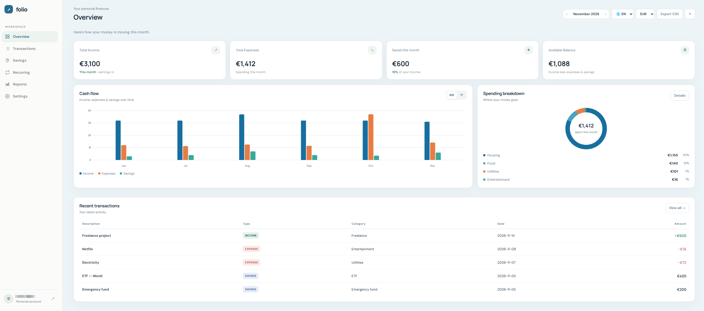

# Folio — Personal Budget Manager

Folio is a lightweight personal finance app for tracking income, expenses, and savings. It runs in the browser and stores account and budget data in that browser's local storage.  It is designed to be easy to use for non-IT users, without requiring any local server setup.

> Dashboard capture.

## Features

- Personal accounts with sign-in, sign-up, and sign-out.
- Admin console for creating users, resetting passwords, and deleting accounts.
- Separate admin category manager. Categories are grouped by expense, income, or saving and can be added or deleted.
- Monthly overview with income, expense, savings, balance, recent transactions, and a category spending breakdown.
- Month navigation, including past and future months, for reviewing and entering transactions.
- Transaction management for income, expense, and saving entries, with categories, saving sub-categories, and platforms such as PEA and CTO.
- Savings goals and contributions.
- Recurring transaction templates.
- Cash-flow, savings, and annual report charts, including year-to-year comparisons. Hover over charts for value labels.
- Monthly and annual CSV exports.
- Household profiles for family members and relationships.
- Light, Dark, Ocean, Lavender, and Sunset themes.
- English and French language selection.
- EUR, GBP, and USD currency display.
- Responsive layout for desktop and mobile screens.

## Getting started

1. Download or clone this repository.
2. Open `index.html` in a modern browser.
3. Sign in with one of the built-in accounts below.

No build step or package installation is required.

## Default accounts

| Role | Username | Password |
| --- | --- | --- |
| Administrator | `admin` | `admin` |
| Demo user | `user1` | `user1` |

NOTE: Connect as admin and change the default passwords.

The built-in credentials are for local demonstration only. Accounts and finance data are stored locally in the browser and are not synchronized between devices.

## Screenshots

Add screenshots to `docs/screenshots/` and update the image paths below.

### Dashboard

### Annual report

### Manage users

## Fonctionnalités (français)

Folio est une application de gestion de budget personnel pour suivre les revenus, les dépenses et l’épargne. Elle fonctionne dans le navigateur et conserve les comptes et les données financières dans le stockage local du navigateur. Il est conçu pour être facilement utilisable par des personnes non spécialisées en informatique, sans nécessiter l'installation ni l'hébergement d'un serveur local.

- Comptes personnels avec connexion, inscription et déconnexion.
- Console d’administration pour créer des utilisateurs, réinitialiser les mots de passe et supprimer des comptes.
- Gestion séparée des catégories, classées par dépenses, revenus ou épargne.
- Vue mensuelle avec revenus, dépenses, épargne, solde, transactions récentes et répartition des dépenses par catégorie.
- Navigation entre les mois passés et futurs pour consulter ou saisir des transactions.
- Transactions de revenus, dépenses et épargne, avec catégories, sous-catégories d’épargne et plateformes telles que PEA et CTO.
- Objectifs d’épargne et contributions.
- Modèles de transactions récurrentes.
- Graphiques de flux de trésorerie, d’épargne et rapports annuels, avec comparaison entre années. Survolez les graphiques pour afficher les valeurs.
- Export CSV mensuel et annuel.
- Profil du foyer avec les membres de la famille et leurs relations.
- Thèmes Clair, Sombre, Océan, Lavande et Coucher de soleil.
- Interface en français et en anglais.
- Affichage des montants en EUR, GBP et USD.
- Interface adaptée aux ordinateurs et aux mobiles.

## Installation

1. Téléchargez ou clonez ce dépôt.
2. Ouvrez `index.html` dans un navigateur récent.
3. Connectez-vous avec l’un des comptes prédéfinis ci-dessus.

Aucune compilation ni installation de dépendances n’est nécessaire.

Les identifiants prédéfinis sont réservés à la démonstration locale. Les comptes et les données budgétaires restent dans le stockage local du navigateur et ne sont pas synchronisés entre appareils.
